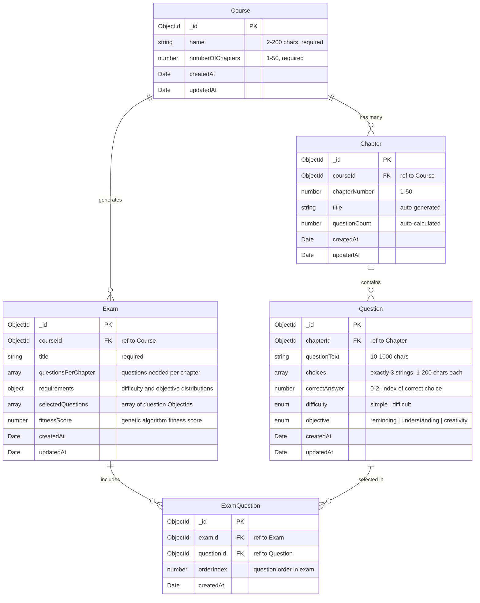

# Exam Design System

An intelligent exam generation platform that uses genetic algorithms to create optimized exams based on educational requirements. This Node.js application provides educators with comprehensive tools for course management, question banking, and automated exam creation.

## 🚀 Key Features

- **Intelligent Exam Generation**: Uses genetic algorithms to optimize question selection
- **Course Management**: Create and manage courses with automatic chapter generation
- **Question Banking**: Categorize questions by difficulty and learning objectives
- **Real-time Validation**: Dynamic requirement validation with helpful feedback
- **Export Functionality**: Print-ready exam formats
- **Responsive Design**: Modern Bootstrap-based interface

## 🛠️ Technology Stack

### Backend
- **Node.js** with **Express.js** framework
- **MongoDB** with **Mongoose** ODM
- **EJS** templating with express-ejs-layouts
- **Express-session** for session management
- **Express-validator** for input validation

### Frontend
- **Bootstrap 5.3.0** for responsive design
- **Font Awesome 6.4.0** for icons
- **jQuery 3.6.0** for dynamic interactions
- Custom CSS with modern design patterns

### Security & Performance
- **Helmet.js** for security headers
- **CORS** for cross-origin requests
- **Compression** middleware
- Content Security Policy (CSP)

## 📋 Functional Requirements

### 1. Course Management
- **Create Courses**: Define courses with configurable number of chapters (1-50)
- **Auto Chapter Generation**: Automatically creates numbered chapters upon course creation
- **Course Statistics**: Real-time tracking of question distribution across chapters
- **CRUD Operations**: Full create, read, update, delete functionality
- **Validation**: Comprehensive input validation with user-friendly error messages

### 2. Question Management
- **Chapter-based Organization**: Questions organized within course chapters
- **Multiple Choice Format**: Each question supports exactly 3 answer choices
- **Difficulty Classification**: Questions categorized as 'simple' or 'difficult'
- **Learning Objectives**: Questions classified by cognitive levels:
  - **Reminding**: Basic recall and recognition
  - **Understanding**: Comprehension and interpretation
  - **Creativity**: Analysis, synthesis, and evaluation
- **Question Limits**: Maximum 12 questions per chapter
- **Real-time Statistics**: Dynamic chapter-level question distribution

### 3. Intelligent Exam Generation
- **Genetic Algorithm Engine**: Advanced AI-powered question selection optimization
- **Multi-criteria Requirements**: Specify exact distribution requirements:
  - Questions per chapter
  - Difficulty distribution (simple vs. difficult)
  - Learning objective distribution (reminding vs. understanding vs. creativity)
- **Requirement Validation**: Comprehensive validation with feasibility checking
- **Fitness Optimization**: Multi-objective fitness function considering:
  - Difficulty distribution adherence
  - Learning objective balance
  - Chapter representation
  - Total question count accuracy
- **Regeneration Capability**: Re-run algorithm with same parameters for different results

### 4. Exam Management
- **Exam Creation**: Generate exams based on specific educational requirements
- **Exam Viewing**: Display generated exams with proper formatting
- **Export Functionality**: Print-ready exam layouts without navigation elements
- **Exam Statistics**: Fitness scores and quality metrics
- **Exam Deletion**: Remove unwanted exam instances

### 5. User Interface Features
- **Responsive Design**: Optimized for desktop, tablet, and mobile devices
- **Interactive Forms**: AJAX-enhanced form validation and submission
- **Real-time Feedback**: Dynamic requirement validation during form completion
- **Flash Messaging**: Success, error, and warning message system
- **Navigation**: Intuitive breadcrumb and menu navigation

## 🔧 Non-Functional Requirements

### Performance
- **Genetic Algorithm Optimization**: 
  - Population size: 100 individuals
  - Generations: 200 maximum
  - Early termination: Stops if no improvement for 50 generations
  - Processing time: Typically < 5 seconds for most exam requirements
- **Database Performance**: Optimized MongoDB queries with proper indexing
- **Response Time**: Page loads < 2 seconds under normal conditions
- **Compression**: Gzip compression for faster data transfer

### Security
- **Input Validation**: Comprehensive server-side validation using express-validator
- **Security Headers**: Helmet.js implementation for security best practices
- **Content Security Policy**: Configured CSP to prevent XSS attacks
- **MongoDB Injection Protection**: Mongoose schema validation and sanitization
- **Session Security**: Secure session configuration with proper expiration

### Reliability
- **Error Handling**: Comprehensive error handling throughout the application
- **Graceful Degradation**: Fallback mechanisms for failed operations
- **Data Validation**: Multi-level validation (client-side and server-side)
- **Automated Testing**: Jest testing framework integration
- **Logging**: Morgan HTTP request logger for debugging and monitoring

### Usability
- **Intuitive Interface**: Clean, modern design following UI/UX best practices
- **Accessibility**: Bootstrap-based responsive design for various devices
- **User Feedback**: Clear error messages and success confirmations
- **Documentation**: Comprehensive inline help and validation messages
- **Progressive Enhancement**: Core functionality works without JavaScript

### Scalability
- **Database Design**: Efficient MongoDB schema with proper relationships
- **Modular Architecture**: Well-organized codebase with separation of concerns
- **Stateless Design**: RESTful API design principles
- **Horizontal Scaling**: Architecture supports load balancing and clustering

### Maintainability
- **Code Organization**: Clear separation between routes, models, and views
- **Documentation**: Comprehensive code comments and API documentation
- **Version Control**: Git-based version control with meaningful commit messages
- **Development Tools**: Nodemon for development auto-reload
- **Testing Framework**: Jest for unit and integration testing

## 📖 Use Cases

### Use Case 1: Course Creation and Setup
**Actor**: Educator
**Goal**: Create a new course with structured chapters

**Main Flow**:
1. Educator navigates to course creation page
2. Enters course name (2-200 characters)
3. Specifies number of chapters (1-50)
4. Submits course creation form
5. System validates input and creates course
6. System automatically generates numbered chapters
7. Educator is redirected to course detail view
8. System displays success message

**Alternative Flows**:
- **3a**: Invalid input provided → System displays validation errors
- **5a**: Course name already exists → System prompts for unique name

### Use Case 2: Question Management
**Actor**: Educator
**Goal**: Add questions to course chapters

**Main Flow**:
1. Educator selects a chapter from course view
2. Clicks "Add Question" button
3. Enters question text (10-1000 characters)
4. Provides exactly 3 answer choices (1-200 characters each)
5. Selects correct answer (0, 1, or 2)
6. Chooses difficulty level (simple/difficult)
7. Selects learning objective (reminding/understanding/creativity)
8. Submits question form
9. System validates and saves question
10. Chapter question count automatically updates

**Alternative Flows**:
- **3a**: Question text too short/long → System shows validation error
- **4a**: Incorrect number of choices → System prompts for exactly 3 choices
- **9a**: Chapter already has 12 questions → System prevents addition

### Use Case 3: Intelligent Exam Generation
**Actor**: Educator
**Goal**: Generate an optimized exam using genetic algorithm

**Main Flow**:
1. Educator navigates to exam creation page
2. Selects target course
3. Enters exam title
4. Specifies questions per chapter for each chapter
5. Sets difficulty distribution requirements (simple vs. difficult)
6. Sets learning objective distribution (reminding/understanding/creativity)
7. System validates requirements in real-time
8. Educator submits exam generation request
9. Genetic algorithm processes requirements
10. System generates optimized question selection
11. Exam is created with fitness score
12. Educator views generated exam

**Alternative Flows**:
- **7a**: Requirements impossible to meet → System provides helpful suggestions
- **9a**: No solution found → System suggests requirement adjustments
- **11a**: Low fitness score → System offers regeneration option

### Use Case 4: Exam Validation and Feedback
**Actor**: Educator
**Goal**: Validate exam requirements before generation

**Main Flow**:
1. Educator fills out exam requirements form
2. System performs real-time validation
3. For each requirement, system checks:
   - Available questions in each chapter
   - Difficulty distribution feasibility
   - Learning objective availability
4. System provides immediate feedback:
   - Green checkmarks for valid requirements
   - Red warnings for impossible requirements
   - Helpful suggestions for adjustments
5. Generate button enables only when all requirements are valid

**Alternative Flows**:
- **3a**: Insufficient questions → System suggests specific chapters needing more questions
- **3b**: Imbalanced difficulty → System recommends difficulty distribution adjustments

### Use Case 5: Exam Export and Printing
**Actor**: Educator
**Goal**: Export exam for student distribution

**Main Flow**:
1. Educator views generated exam
2. Clicks "Export for Printing" button
3. System opens print-optimized view
4. Layout removes navigation and unnecessary elements
5. Questions display in clean, numbered format
6. Educator uses browser print function
7. System returns to normal view after printing

### Use Case 6: Course Statistics and Analytics
**Actor**: Educator
**Goal**: Monitor course question distribution

**Main Flow**:
1. Educator views course detail page
2. System displays real-time statistics:
   - Total questions across all chapters
   - Questions per chapter breakdown
   - Difficulty distribution chart
   - Learning objective distribution
3. Educator identifies chapters needing more questions
4. System provides direct links to add questions to specific chapters

## 🗄️ Entity Relationship Diagram



## 🚀 Installation and Setup

### Prerequisites
- **Node.js** (v14 or higher)
- **MongoDB** (v4.0 or higher)
- **npm** (comes with Node.js)

### Installation Steps

1. **Clone the repository**
   ```bash
   git clone <repository-url>
   cd exam-design-system
   ```

2. **Install dependencies**
   ```bash
   npm install
   ```

3. **Environment Configuration**
   Create a `.env` file in the root directory:
   ```env
   PORT=3000
   MONGODB_URI=mongodb://localhost:27017/exam_system
   SESSION_SECRET=your-secret-key-here
   NODE_ENV=development
   ```

4. **Start MongoDB**
   Ensure MongoDB is running on your system:
   ```bash
   # On macOS with Homebrew
   brew services start mongodb

   # On Ubuntu/Debian
   sudo systemctl start mongod

   # On Windows
   net start MongoDB
   ```

5. **Run the application**
   
   **Development mode** (with auto-reload):
   ```bash
   npm run dev
   ```
   
   **Production mode**:
   ```bash
   npm start
   ```

6. **Access the application**
   Open your browser and navigate to: `http://localhost:3000`

### Testing

Run the test suite:
```bash
npm test
```

## 📚 Endpoints

### Course Management
- `GET /courses` - List all courses
- `GET /courses/create` - Show course creation form
- `POST /courses` - Create new course
- `GET /courses/:id` - Show course details
- `GET /courses/:id/edit` - Show course edit form
- `PUT /courses/:id` - Update course
- `DELETE /courses/:id` - Delete course
- `GET /courses/:id/statistics` - Get course statistics

### Question Management
- `GET /questions/chapter/:chapterId` - List questions in chapter
- `GET /questions/chapter/:chapterId/create` - Show question creation form
- `POST /questions/chapter/:chapterId` - Create new question
- `GET /questions/:id` - Show question details
- `GET /questions/:id/edit` - Show question edit form
- `PUT /questions/:id` - Update question
- `DELETE /questions/:id` - Delete question
- `GET /questions/chapter/:chapterId/stats` - Get chapter question statistics

### Exam Management
- `GET /exams` - List all exams
- `GET /exams/create` - Show exam creation form
- `POST /exams/generate` - Generate exam using genetic algorithm
- `GET /exams/:id` - Show exam details
- `DELETE /exams/:id` - Delete exam
- `GET /exams/:id/export` - Export exam for printing
- `POST /exams/:id/regenerate` - Regenerate exam with same parameters
- `GET /exams/course/:courseId/info` - Get course information for exam creation
- `POST /exams/validate` - Validate exam requirements

## 🧬 Genetic Algorithm Details

The intelligent exam generation feature uses a sophisticated genetic algorithm with the following characteristics:

### Algorithm Parameters
- **Population Size**: 100 individuals
- **Maximum Generations**: 200
- **Early Termination**: Stops if no improvement for 50 generations
- **Tournament Size**: 5 individuals
- **Crossover Rate**: 0.8
- **Mutation Rate**: 0.1

### Fitness Function
The fitness function evaluates solutions based on multiple criteria:

1. **Difficulty Distribution**: How well the selected questions match required simple/difficult ratios
2. **Learning Objective Distribution**: Adherence to reminding/understanding/creativity requirements
3. **Chapter Balance**: Even distribution of questions across chapters
4. **Total Count Accuracy**: Exact match of total question requirements

### Genetic Operators
- **Selection**: Tournament selection for parent choosing
- **Crossover**: Single-point crossover for solution combination
- **Mutation**: Random question replacement for diversity
- **Elitism**: Best solutions preserved across generations


## 📄 License

This project is licensed under the MIT License - see the LICENSE file for details.


**Built with ❤️ By: Mahmoud Abas**